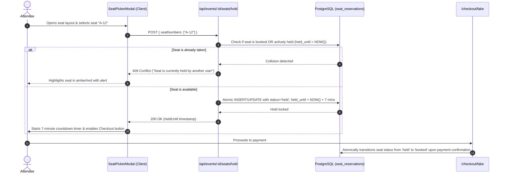

# Gatherly - Architecture & System Design Document

## 1. High-Level System Architecture

```mermaid
flowchart TB
    subgraph ClientLayer [Presentation Layer - Next.js 16 App Router & React 19]
        WebClient[Web Browser / Mobile PWA]
        LivePulse[Live Real-Time Countdown & Scarcity]
        SeatPicker[Interactive SVG Seat Map & Hold Lock]
        GateScanner[Fullscreen Gate QR & Barcode Scanner]
        AIChatbot[Gatherly AI Concierge Widget]
        AdminConsole[Admin & Fraud Telemetry Console]
    end

    subgraph SecurityMiddleware [Security & Rate Limiting Guardrails]
        RateLimiter[Sliding Window In-Memory Rate Limiter]
        SecurityHeaders[HSTS, CSP, nosniff, frame-options]
        AuthGuard[Stateless JWT & Refresh Token Rotation]
    end

    subgraph ApiRouteHandlers [Next.js Route Handlers / Server Endpoints]
        AuthAPI[/api/auth/*]
        EventsAPI[/api/events/*]
        SeatAPI[/api/events/:id/seats/*]
        PaymentAPI[/api/checkout, /api/payments/*]
        TicketAPI[/api/bookings/:id/*]
        AdminAPI[/api/admin/*]
        AIAPI[/api/ai/*]
        MarketingAPI[/api/marketing/*]
    end

    subgraph CoreServices [Core Domain Engines]
        SeatEngine[Atomic Seat Hold & Double-Booking Lock]
        PaymentService[Multi-Gateway Payment Engine & EMI Plans]
        BarcodeQRService[Pure Vector SVG Barcode & QR Generator]
        PDFService[PDFKit Vector Ticket & Tax Invoice Engine]
        NotificationService[5-Channel Dispatcher Email, SMS, WhatsApp, Push, In-App]
        AIService[AI Description, SEO, Banner Prompts & Fraud Scoring]
        MarketingService[Dynamic Surge & Early Bird Pricing Calculator]
        CacheService[Multi-tier In-Memory LRU & Redis Cache]
        JobQueue[Asynchronous Deferred Worker Queue]
    end

    subgraph Persistence [PostgreSQL & Drizzle ORM]
        PostgreSQL[(PostgreSQL Relational Database)]
    end

    WebClient --> SecurityMiddleware
    SecurityMiddleware --> ApiRouteHandlers
    ApiRouteHandlers --> CoreServices
    CoreServices --> Persistence
    CoreServices --> JobQueue
```

---

## 2. Interactive Seat Booking & Hold Lock Lifecycle



---

## 3. QR Gate Entry & Duplicate Scan Prevention

```mermaid
flowchart TD
    Scan([Gate Usher Scans QR Code / Barcode]) --> API[/api/events/:id/check-in]
    API --> DBQuery[(Lookup booking by reference & eventId)]

    DBQuery --> Found{Booking exists?}
    Found -- No --> Invalid[Reject: Invalid Ticket Code]

    Found -- Yes --> StatusCheck{Status == 'confirmed'?}
    StatusCheck -- No --> Void[Reject: Ticket Cancelled / Refunded]

    StatusCheck -- Yes --> CheckInCheck{isCheckedIn == true?}
    CheckInCheck -- Yes --> Duplicate[⚠️ ALERT: Duplicate Scan Detected!\nAlarm tone sounds, displays first check-in time]
    CheckInCheck -- No --> Admit[✅ ADMIT: Welcome Attendee!\nPass chime sounds, atomic UPDATE isCheckedIn=true, checkInCount=1]
```
