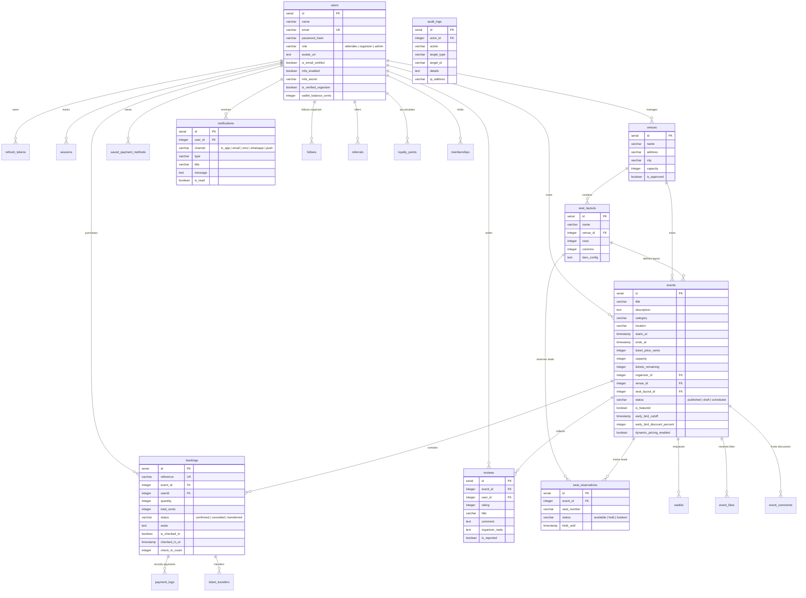

# Gatherly - Relational Database Schema & ER Diagram

The Gatherly database is built on **PostgreSQL** and orchestrated through **Drizzle ORM** (`src/db/schema.ts`).

## Entity-Relationship Diagram

